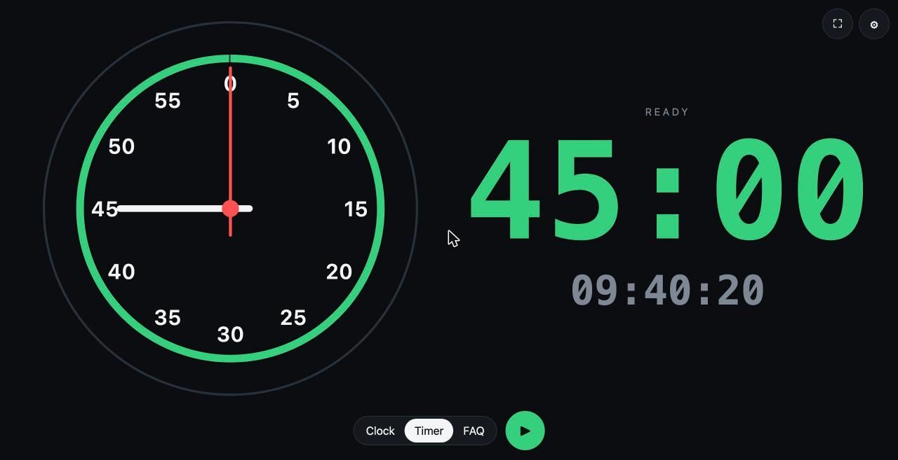
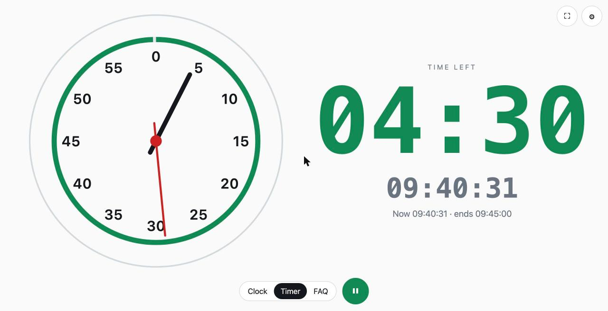
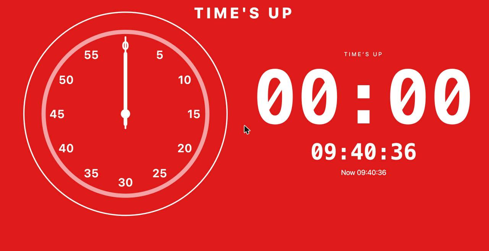
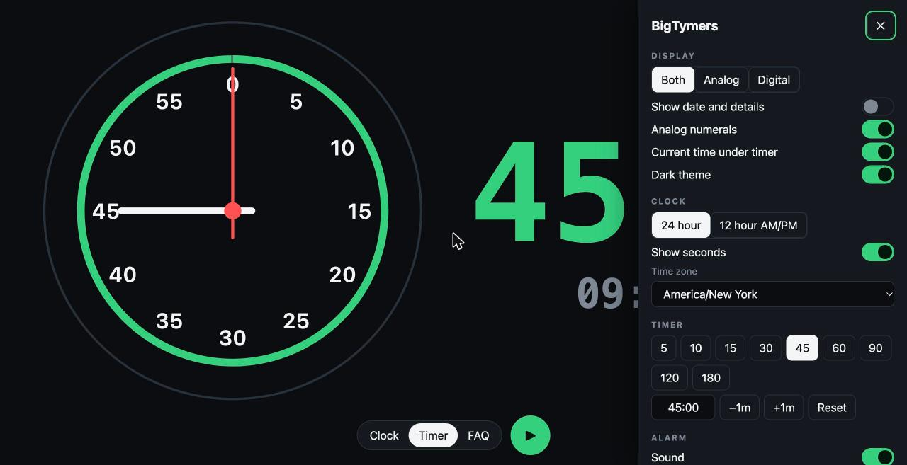
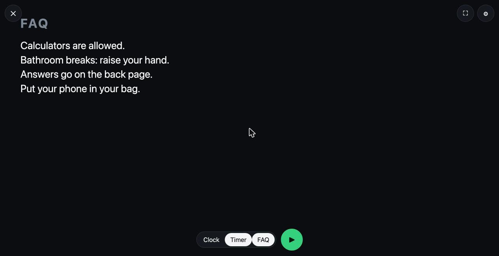

# BigTymers

A minimal full screen clock and countdown timer for exams and presentations.
It runs in the browser and in the terminal.

<p align="center">
  
</p>

Browser: https://ceg.me/bigtymers

Terminal, with nothing to download:

```
curl -fsSL https://ceg.me/bigtymers/bigtymers.py | python3 - 45m
```

The terminal version needs only Python 3.9 or newer and no packages.
Keys are read from the terminal device, so piping the script into Python works.

## Screenshots

<table>
  <tr>
    <td width="50%"></td>
    <td width="50%"></td>
  </tr>
  <tr>
    <td align="center">Light theme, running timer with the current time and end time</td>
    <td align="center">The screen flashes red when the timer reaches zero</td>
  </tr>
  <tr>
    <td width="50%"></td>
    <td width="50%"></td>
  </tr>
  <tr>
    <td align="center">Settings stay hidden until you open them</td>
    <td align="center">Instructor FAQ notes shown full screen</td>
  </tr>
</table>

## Features

- Analog face, digital face, or both, with a dark or light theme.
- Clock view for the current time and timer view for the time left.
- The timer ring and digits turn amber and then red as time runs low.
- Optional current time under the timer, so students see both without switching views.
- Optional instructor FAQ with notes you write once and show full screen with one key.
- An alarm that flashes the screen and sounds until someone dismisses it.
- Link options that start the page in a chosen state.
- A terminal version with the same faces and keys.

The main screen shows only the time.
Everything else is in settings, which are hidden until needed.

<details>
<summary>Install the btyme command</summary>

On Linux or macOS with Python 3.9 or newer, this installs `btyme` into `~/.local/bin`:

```
curl -fsSL https://ceg.me/bigtymers/install.sh | sh
btyme 45m
```

If `~/.local/bin` is not on your PATH, the installer prints the line to add.
Set `BTYME_DIR` to install somewhere else.
Remove it with `curl -fsSL https://ceg.me/bigtymers/install.sh | sh -s -- --uninstall`.

With pipx or uv instead:

```
pipx install git+https://github.com/cegme/bigtymers
uv tool install git+https://github.com/cegme/bigtymers
uvx --from git+https://github.com/cegme/bigtymers btyme 45m
```

The last line runs it once without installing.

</details>

<details>
<summary>Debian, Ubuntu, Fedora and Red Hat packages</summary>

Each release has a `.deb` and an `.rpm` package that install `btyme` system wide.

```
# Debian and Ubuntu
curl -fsSLO https://github.com/cegme/bigtymers/releases/latest/download/btyme_all.deb
sudo apt install ./btyme_all.deb

# Fedora, RHEL, Rocky Linux and AlmaLinux
sudo dnf install https://github.com/cegme/bigtymers/releases/latest/download/btyme.noarch.rpm
```

Remove them with `sudo apt remove btyme` or `sudo dnf remove btyme`.

The packages need Python 3.9 or newer.
That is included in Debian 11 and later, Ubuntu 22.04 and later, Fedora, and RHEL 9 and later.
On RHEL 8 install `python39` and start it with `python3.9 /usr/bin/btyme`.

To build the packages yourself, run `sh packaging/build-deb.sh` (needs `dpkg-deb`) or `sh packaging/build-rpm.sh` (needs `rpmbuild`).
Pushing a tag such as `v0.1.1` builds both and publishes a release through GitHub Actions.

</details>

<details>
<summary>Browser keys and settings</summary>

The controls fade out when the mouse is idle.
Open settings with the gear or the `s` key.

| Key | Action |
| --- | --- |
| Space | Start or pause the timer, or dismiss the alarm |
| v | Switch between current time and time left |
| a | Cycle both, analog and digital |
| f | Full screen (double click also works) |
| s | Settings |
| + / - | Add or remove 1 minute |
| Up / Down | Add or remove 5 minutes |
| r | Reset the timer |
| h | 12 hour (AM/PM) or 24 hour clock |
| m | Mute the alarm |
| n | Show or hide the FAQ (when enabled) |

Settings include face, 12 or 24 hour time, seconds, time zone, date line, analog numerals, current time under the timer, theme, timer presets, the alarm and the instructor FAQ.
The alarm has 6 tones (beep, chime, bell, siren, buzzer, digital watch), a volume slider, a repeat count (3 times by default), and an optional cue at 5 minutes and 1 minute left.
Settings are remembered in the browser.
The screen is kept awake while the page is open.

Browsers only play sound after the page has been clicked or a key has been pressed once.
Press any key when the page opens to arm the alarm sound.

</details>

<details>
<summary>Instructor FAQ</summary>

Turn on Instructor FAQ in settings to add an FAQ button next to Clock and Timer.
Write notes for students in the box that appears in settings, such as whether calculators are allowed or where answers go.
Press the FAQ button, or `n`, to show the notes full screen in large text.
Line breaks are kept and long notes scroll.
Close the FAQ with `Esc`, the close button, or by choosing Clock or Timer.
The FAQ closes by itself when the alarm fires.

Notes are plain text and stay in this browser.
Nothing is sent anywhere.

</details>

<details>
<summary>Link options</summary>

Link options start the page in a given state.

```
https://ceg.me/bigtymers/?t=45m&go&face=analog&tz=Europe/London&h12=1&seconds=0&details=1&tone=bell
```

| Option | Meaning |
| --- | --- |
| t | Timer length: 45, 45m, 90s, 1h30m, 1:30:00. A bare number is minutes. |
| go | Start the timer immediately (needs t) |
| view | clock or timer |
| face | both, analog or digital |
| tz | IANA time zone such as Asia/Tokyo |
| h12, seconds, details, numerals | 1 or 0 |
| now | 1 or 0, show the current time under the timer |
| faq | 1 or 0, enable the instructor FAQ |
| tone | beep, chime, bell, siren, buzzer, digital |
| theme | dark or light |

A link option replaces the saved setting for that option.

</details>

<details>
<summary>Terminal version</summary>

```
btyme [duration] [--view clock|timer] [--face both|analog|digital]
             [--tz ZONE[,ZONE...]] [--12] [--no-seconds] [--details]
             [--sound NAME_OR_FILE] [--no-bell] [--paused]
```

Examples:

```
btyme 90m --face analog
btyme --tz local,Asia/Tokyo --12
btyme 1h30m --sound Glass
```

Giving a duration starts the timer.
Without one, the clock is shown.
Make the terminal window full screen for the largest display.

| Key | Action |
| --- | --- |
| space | Start or pause, or dismiss the alarm |
| v | Switch between clock and timer |
| a | Cycle faces |
| + / - | Add or remove 1 minute |
| Up / Down | Add or remove 5 minutes |
| r | Reset |
| h | 12 or 24 hour clock |
| s | Show or hide seconds |
| z | Cycle through the zones given with `--tz` |
| d or ? | Show or hide the header and help line |
| m | Mute |
| q | Quit |

The alarm flashes the screen until it is dismissed and rings the terminal bell 3 times.
`--repeat N` changes the count, and `--repeat 0` rings until dismissed.
`--sound` plays a file instead.
On macOS use a system sound name such as Glass, Submarine or Hero, or a path to an audio file.
Playback uses `afplay`, `paplay` or `aplay`, whichever is installed.

</details>

<details>
<summary>Hosting</summary>

The site is served by GitHub Pages from the main branch.
The `ceg.me` domain is set on the `cegme.github.io` user site, so this repository is served at `ceg.me/bigtymers`.

</details>

## License and credit

BigTymers is free to use and modify under the MIT License.
If you use it in a course, an exam or an organization, I would love to hear about it.
Open an issue at https://github.com/cegme/bigtymers/issues to let me know.
